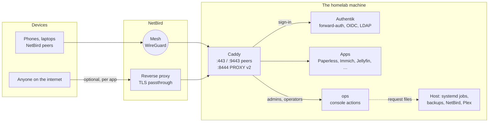
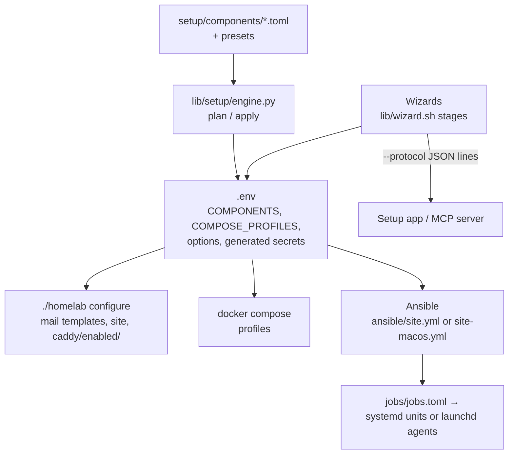

# Architecture

## Who reaches what

- **No port on the router.** Peers reach the machine over NetBird; public sites (only those you choose) come
  through NetBird's reverse proxy in TLS passthrough to `:8444` with PROXY protocol v2, so TLS ends on the
  machine. Caddy listens on the NetBird address only.
- **The LAN sees the machine, not the homelab.** The Ansible `firewall` role makes `homelab-lan` firewalld's
  default zone (DHCPv6, mDNS, NetBird's port, Matter devices, whatever `LAN_ALLOW` adds), routes nothing from
  the LAN, and drops anything for the NetBird address that doesn't come from NetBird, the machine itself or its
  containers: firewalld accepts Docker's published ports (DNAT) before any zone. The step `hardening:firewall`
  (the setup app's "LAN firewall") runs it: a dry run first, an undo timer over SSH, then the checks.
- **One sign-in.** Caddy asks Authentik's outpost for every request (forward-auth) or the app speaks OIDC to
  Authentik itself; Jellyfin's apps use LDAP. Groups decide who sees what (`site/apps.json`).
- **SSH, if chosen, also through Authentik**: a key from your Authentik profile, then your password and code
  (SSSD and an LDAP outpost on the host, NetBird only). The home page's SSH keys sheet lists the keys; adding or
  removing one happens in Authentik's own flows, with your passkey every time and only from NetBird, and every
  change is mailed to you.
- **Apps** are Docker containers on one compose network (the downloads apps and the request page on networks of
  their own), none with a published port; Caddy and the fixed addresses in `docker-compose.yml` are the only ways in.
- **Downloads, if chosen, only through a VPN.** gluetun's WireGuard tunnel holds qBittorrent, Prowlarr and Byparr
  in its network namespace with a kill switch: torrent peers and search sites see the VPN's address only, and with
  the tunnel down nothing of theirs goes out. With Radarr, Sonarr, Recyclarr, Lidarr, Bazarr and Bindery they share
  a compose network with Caddy and nothing else; Seerr, the family's public request page, shares another with
  Radarr, Sonarr and Caddy only. Authentik's sign-in is the only one a person uses: behind forward-auth each app
  lets in what Caddy's fixed address forwards (the Servarr apps count a NetBird peer as local, and those networks
  are on documentation ranges, so a neighbour never is), Caddy fills in Bazarr's login, Bindery speaks OIDC, Seerr
  signs in through Jellyfin. Every app's own password and API key is generated. The provider's forwarded port
  (Proton: NAT-PMP) is open on the VPN's address, never on the router or the machine.

## What's set up how

- **Components** are data: requires/suggests/conflicts, platforms, services (compose profiles), Caddy files,
  blueprints, jobs, options (type, default, generator, secret), tiles and wizard stages. The engine resolves a
  choice, explains what it adds and why, and writes `.env`.
- **`./homelab configure`** renders what comes from `.env` (mail templates, the home page's app list, the
  chosen components' Caddy files into `caddy/enabled/`). Generated files are gitignored.
- **Ansible** is the host: packages and repos per distro (`ansible/distro/`, `roles/*/tasks/<family>.yml`),
  Docker, NetBird, the GPU toolkit, mounts, SSH via Authentik (Fedora), and the jobs. It never touches compose.
- **Jobs** are one registry (`jobs/jobs.toml`): systemd units on Linux (templates in the timers role), launchd
  agents on macOS (`lib/jobs.py plists`), the polkit rule, the console's actions, `./homelab status`.

## The setup front ends

The wizards are bash (`*-wizard.sh`, one library `lib/wizard.sh`) and speak two ways: to a terminal, or as
JSON lines (`./homelab setup --protocol`) for the setup app (`setup-app/`, Tauri, local or over SSH) and the
MCP server (`lib/setup/mcp.py`) that assistants use. Secrets only travel inward: a front end may send one, no
message ever carries one back. Under `--protocol`, `sudo` asks through the front end (`lib/setup/askpass.py`).

## Proving nothing changed

`tests/golden.sh` renders compose, Ansible's values, the units, the blueprints, everything `configure` writes
and a request-by-request table of what Caddy answers (`tests/caddy/matrix.py`, a real Caddy with stub
upstreams and a stub Authentik), for each instance under test (`tests/fixtures/full.env`: an example with every
component), and compares them with that instance's `tests/golden/<name>/`.
CI runs it with the unit tests, shellcheck, the setup app's tests, and every distro's packages in containers.
